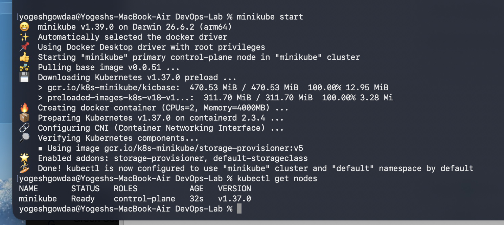
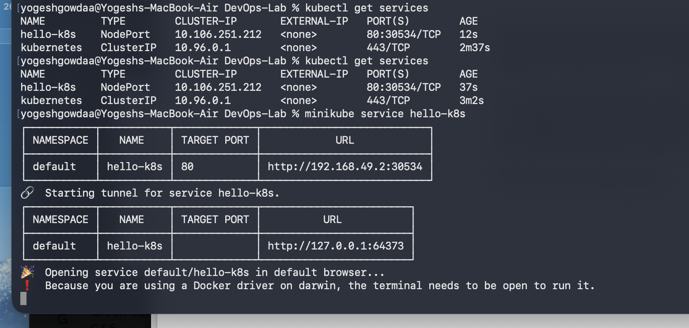
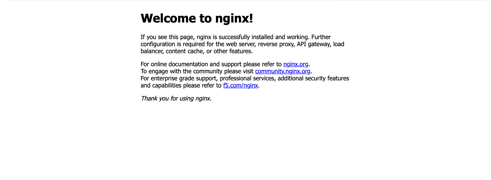

# Exercise 1: Kubernetes Hello Pod

## Objective
Deploy an Nginx web server on a local Kubernetes cluster using Minikube.

## Steps performed

### 1. Start the Kubernetes cluster
```bash
minikube start
kubectl get nodes
```
**Result:** The Minikube node reached `Ready` status.



### 2. Create the Pod
```bash
kubectl run hello-k8s --image=nginx --port=80
kubectl get pods
```
**Result:** The `hello-k8s` Pod reached `Running` status. The command output was verified during the exercise.

### 3. Expose the Pod
```bash
kubectl expose pod hello-k8s --type=NodePort --port=80
kubectl get services
```
**Result:** The `hello-k8s` Service was created as a `NodePort` service, exposing port 80 through node port 30534.



### 4. Access the application
```bash
minikube service hello-k8s
```
**Result:** The Nginx welcome page opened successfully in the browser. On macOS with the Docker driver, the terminal running the service tunnel must remain open while using the tunnel URL.



## Concepts learned
- **Minikube:** Runs a local Kubernetes cluster.
- **Pod:** The smallest deployable unit in Kubernetes.
- **Container image:** The `nginx` image provides the web server.
- **Service:** Provides network access to Pods.
- **NodePort:** Exposes a Service through a port on the node.

## Verification
- [x] Kubernetes node is `Ready`.
- [x] Nginx Pod is `Running` (verified in terminal during the exercise).
- [x] NodePort Service is created.
- [x] Nginx welcome page opened successfully.
