# Exercise 3: Scaling a Flask App on a Single Node Using ReplicaSets

## Real-World Use Case: E-commerce Flash Sale

During a flash sale, an e-commerce service may experience a sudden increase in requests. Kubernetes ReplicaSets help maintain a desired number of application Pods. If a Pod is deleted or fails, the ReplicaSet creates a replacement to maintain the desired replica count.

## Objectives

- Understand Kubernetes ReplicaSets and Pods.
- Containerize a Flask application with Docker.
- Build and publish a Docker image.
- Run the application on a single-node Minikube cluster.
- Scale the ReplicaSet and observe Kubernetes self-healing.

## Application

The Flask app provides three endpoints:

- `/` — returns a welcome message, the serving Pod hostname, and a timestamp.
- `/buy` — simulates a flash-sale purchase and returns a randomly selected product, user, serving Pod, and time.
- `/health` — returns the application's health status and Pod hostname for Kubernetes probes.

Source: [`app.py`](app.py)

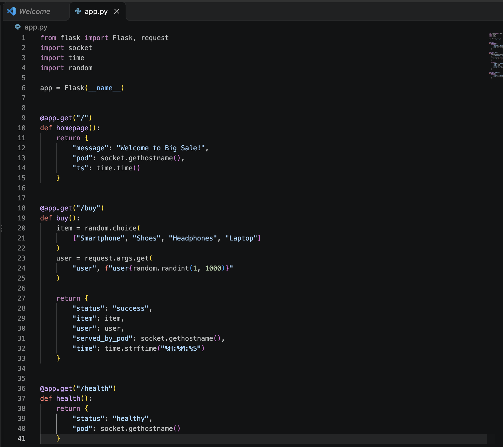

## Docker Image

The Dockerfile uses Python 3.11 slim, copies `app.py` into the image, installs Flask and Gunicorn, and starts the app with Gunicorn on port 5000.

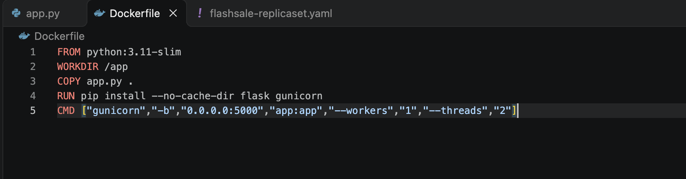

Build the image and push it to Docker Hub:

```bash
docker build -t yogeshg5/flashsale:1.0 .
docker login
docker push yogeshg5/flashsale:1.0
```

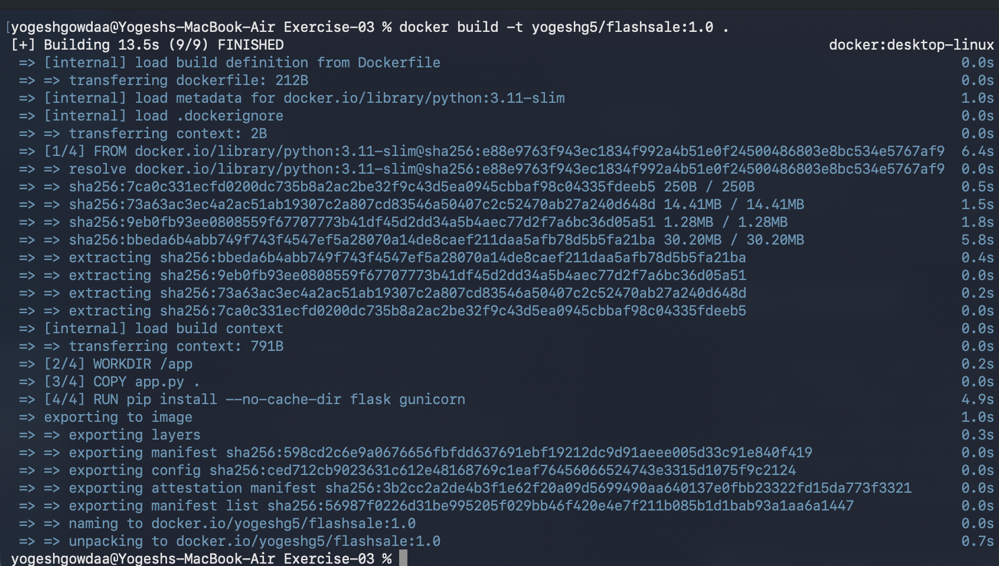

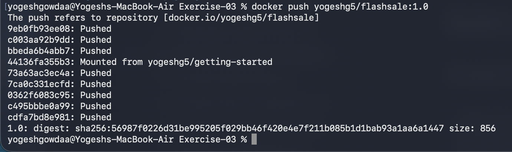

## Start Minikube

The cluster was restarted and launched with one node:

```bash
minikube stop
minikube delete
minikube start --nodes=1
kubectl get nodes
```

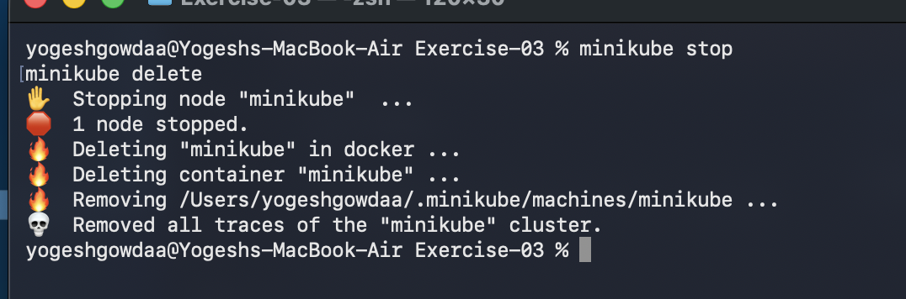

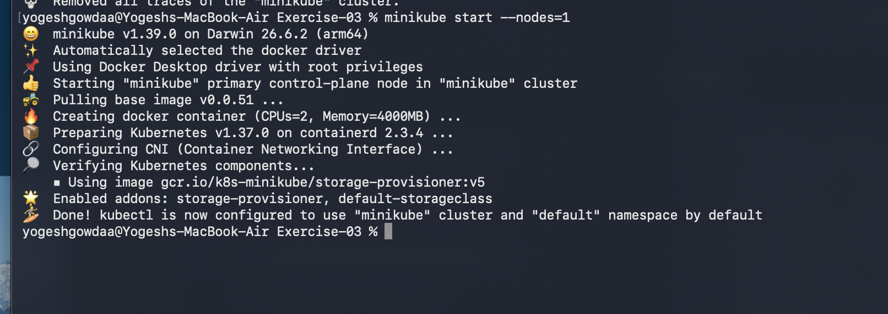

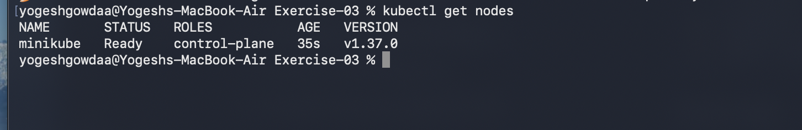

## Configure the ReplicaSet and Service

The manifest `flashsale-replicaset.yaml` defines a ReplicaSet named `flashsale-rs` with three replicas. It also defines a `ClusterIP` Service named `flashsale-svc` that routes port 80 to the application on port 5000. Readiness and liveness probes use `/health`, and resource requests and limits are specified for each container.

Use the image name consistently in the manifest:

```yaml
image: yogeshg5/flashsale:1.0
imagePullPolicy: IfNotPresent
```

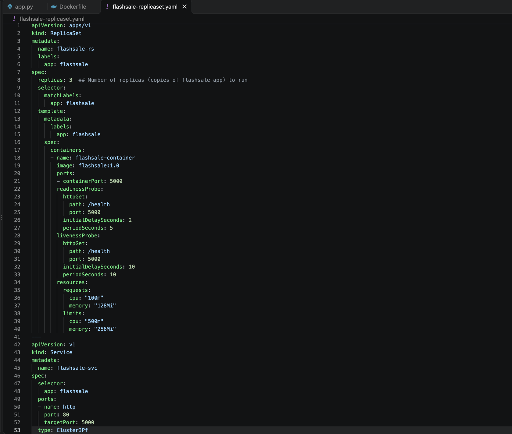

Apply the configuration:

```bash
kubectl apply -f flashsale-replicaset.yaml
```

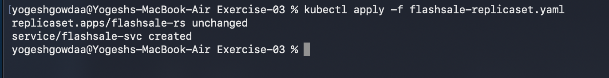

Because Minikube uses containerd, the local Docker Desktop image can be loaded into Minikube with:

```bash
docker build -t yogeshg5/flashsale:1.0 .
minikube image load yogeshg5/flashsale:1.0
```

The `minikube docker-env` workflow was not used for the final working setup.

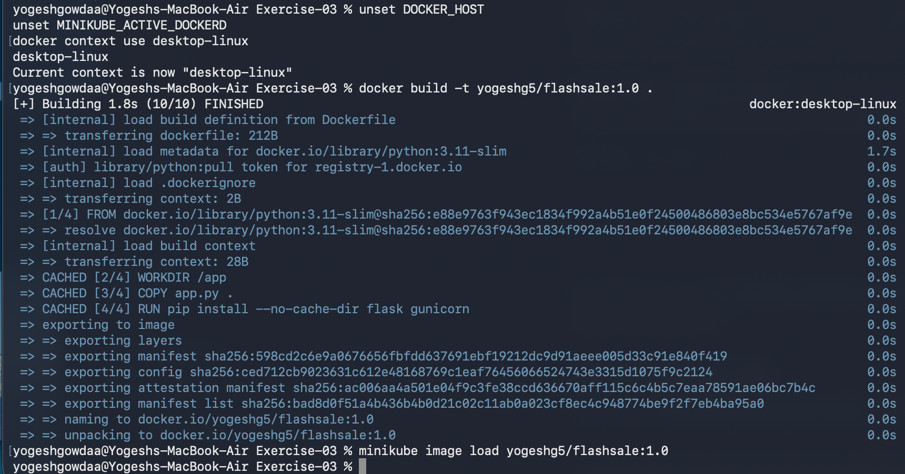

## Verify and Scale the ReplicaSet

Check the initial Pods and ReplicaSet:

```bash
kubectl get pods
kubectl get rs
```

The initial configuration maintains three replicas.

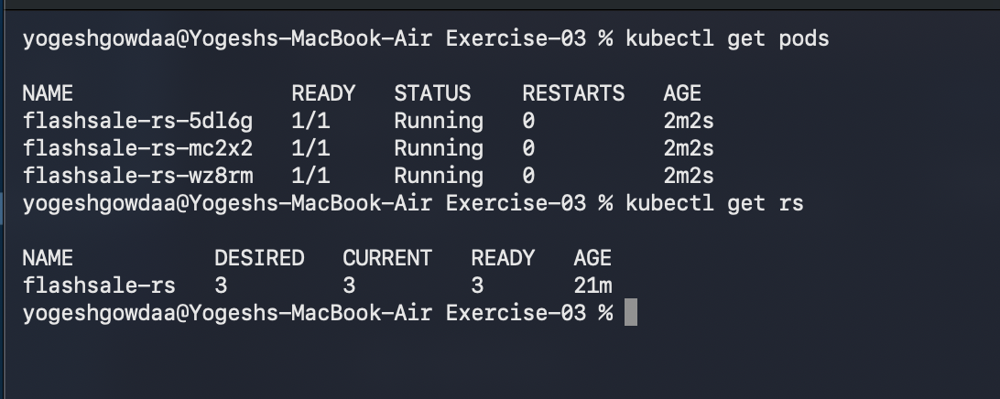

Scale the ReplicaSet to five replicas:

```bash
kubectl scale rs flashsale-rs --replicas=5
```

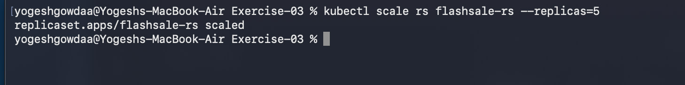

Verify that the ReplicaSet has five ready replicas and that all five Pods are running:

```bash
kubectl get rs
kubectl get pods
```

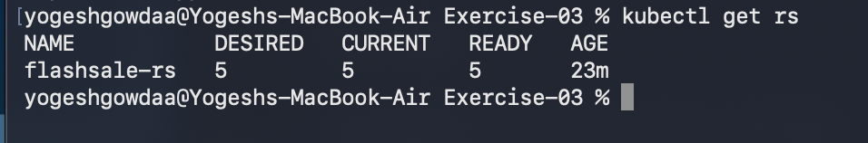

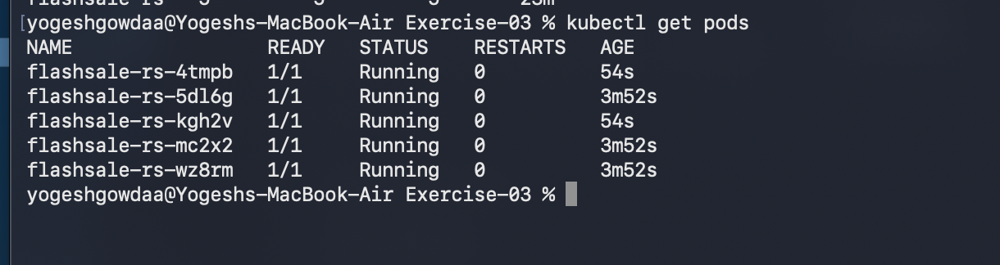

## Demonstrate Self-Healing

Delete one Pod by using its current name:

```bash
kubectl delete pod <pod-name>
```

The ReplicaSet detects that the number of Pods has fallen below the desired count and creates a replacement.

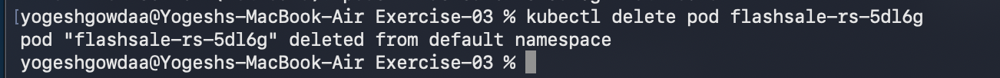

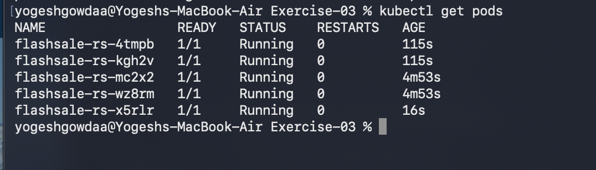

## Observe Pod Placement

Use the following command to see Pod IP addresses and the node on which each Pod runs:

```bash
kubectl get pods -o wide
```

All five Pods run on the single Minikube node in this exercise.

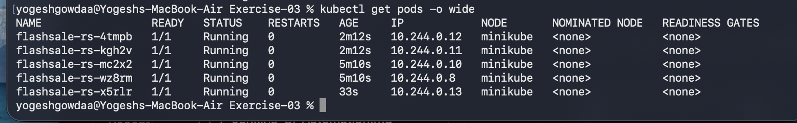

## Key Learnings

- **Replica management:** A ReplicaSet maintains the requested number of Pods.
- **Scaling:** Changing the replica count from three to five causes Kubernetes to create two additional Pods.
- **Self-healing:** Deleting a Pod causes the ReplicaSet to create a replacement.
- **Single-node placement:** With a single-node cluster, all five Pods run on that node.
- **Image availability:** The image name in the Kubernetes manifest must match the image available in Minikube or a registry the cluster can access.

## Questions and Answers

**1. What was the initial replica count?**  
Three.

**2. What happened when the ReplicaSet was scaled to five?**  
Kubernetes created two additional Pods to reach the desired count of five.

**3. What happens when one Pod is deleted?**  
The ReplicaSet creates a replacement Pod to maintain five replicas.

**4. How many nodes are used?**  
One Minikube node.

**5. How can Pod placement be inspected?**  
Run `kubectl get pods -o wide` to view Pod IPs and node names.

## Additional Challenges

- Change the container image and update the ReplicaSet.
- Create a Deployment instead of a standalone ReplicaSet.
- Use `kubectl describe` and `kubectl logs` to inspect Pods and application behavior.
