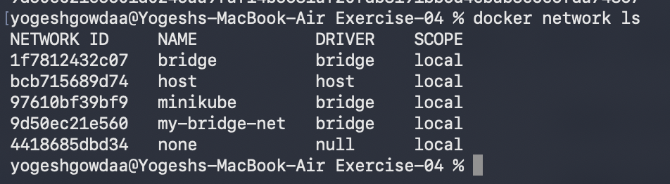
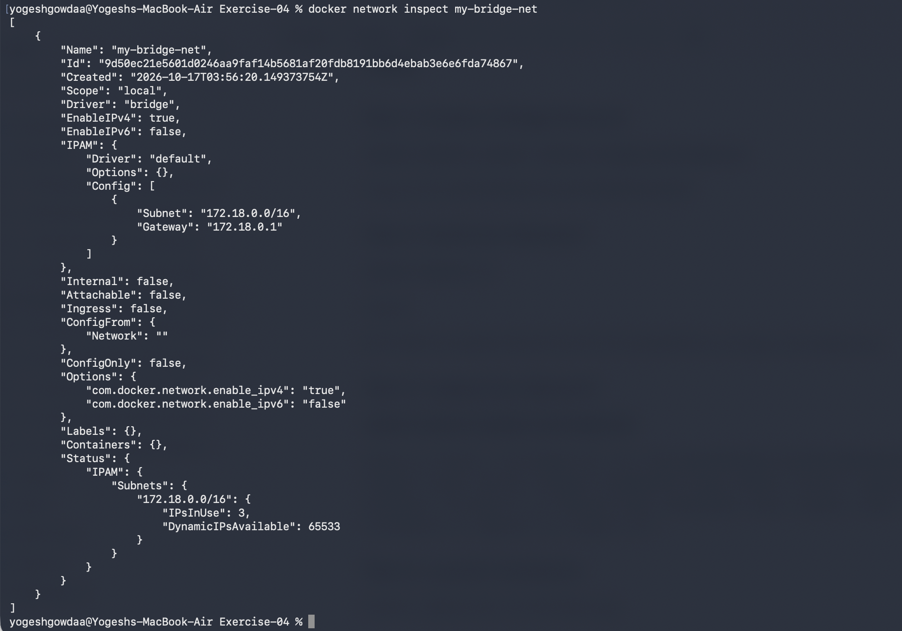
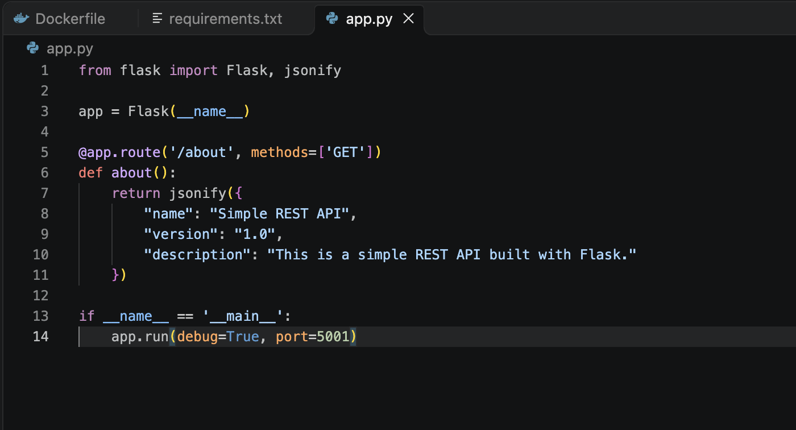
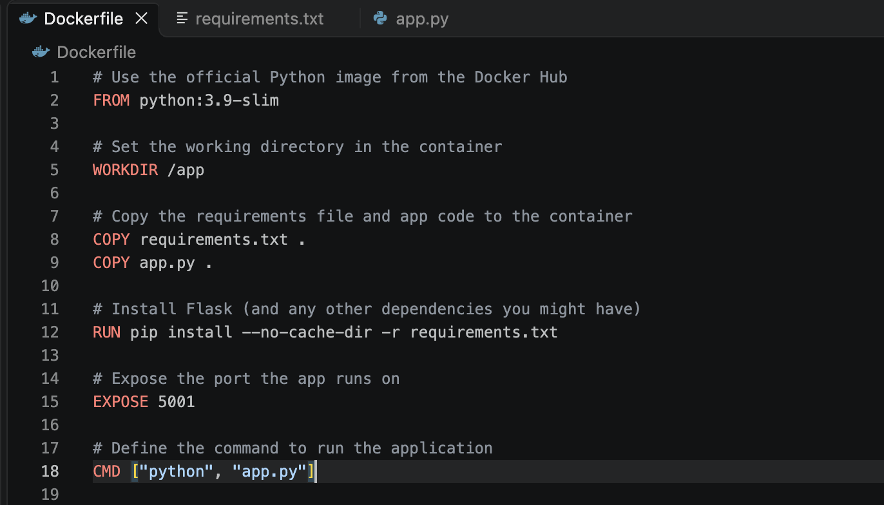
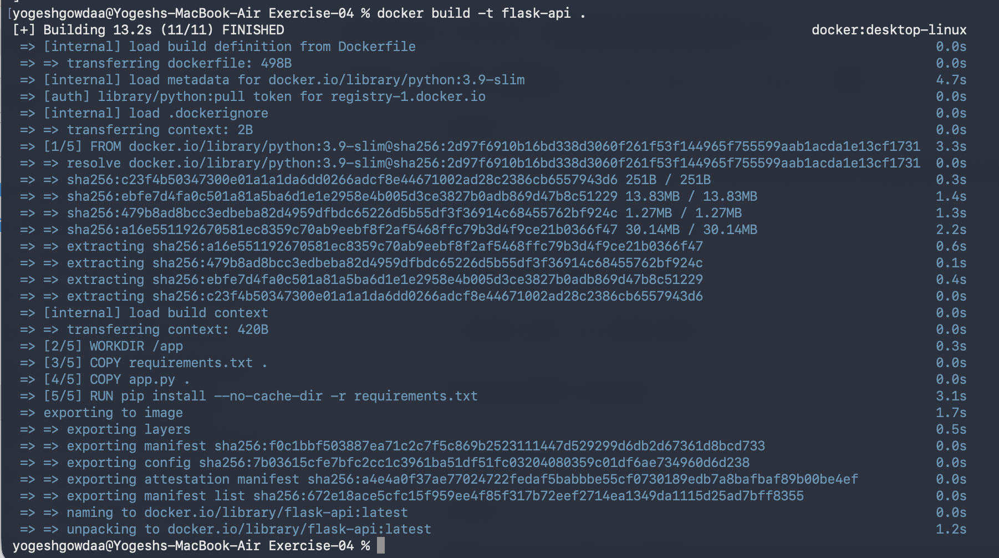
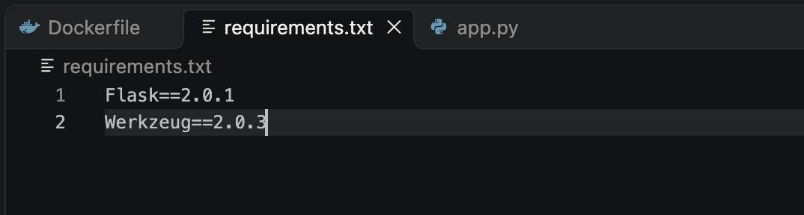
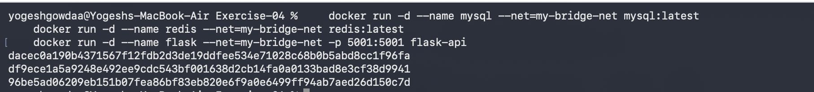
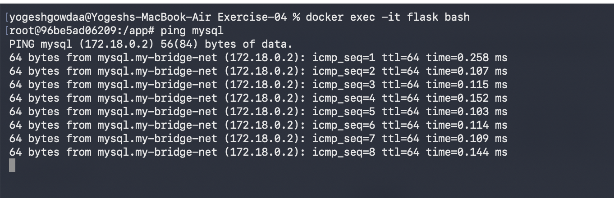
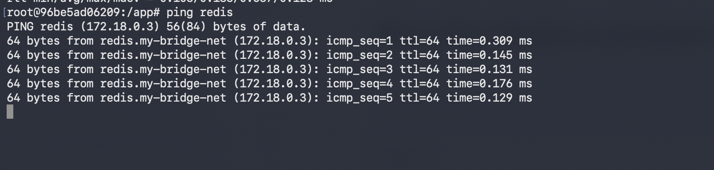
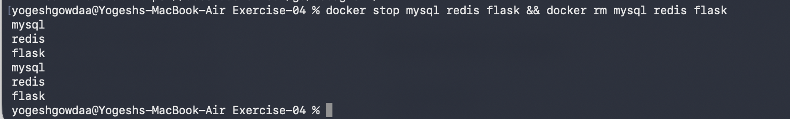

# Docker Networking with Multiple Containers

## Objective

Understand Docker bridge networking and connect multiple containers through a user-defined bridge network.

## Create and inspect the bridge network

Create the network:

```bash
docker network create --driver bridge my-bridge-net
```

List the available networks and confirm that `my-bridge-net` uses the `bridge` driver.

```bash
docker network ls
```

Inspect the network configuration:

```bash
docker network inspect my-bridge-net
```

The network uses a local bridge driver. Before containers are connected, the `Containers` field is empty.






## Build the Flask image

Create `app.py` with a simple REST endpoint:

```python
from flask import Flask, jsonify

app = Flask(__name__)

@app.route('/about', methods=['GET'])
def about():
    return jsonify({
        "name": "Simple REST API",
        "version": "1.0",
        "description": "This is a simple REST API built with Flask."
    })

if __name__ == '__main__':
    app.run(host='0.0.0.0', debug=True, port=5001)
```

Set the dependencies in `requirements.txt`. Werkzeug is pinned to a Flask-compatible version to avoid the `url_quote` import error.

```text
Flask==2.0.1
Werkzeug==2.0.3
```

Use the following `Dockerfile`:

```dockerfile
FROM python:3.9-slim
WORKDIR /app
COPY requirements.txt .
COPY app.py .
RUN pip install --no-cache-dir -r requirements.txt
EXPOSE 5001
CMD ["python", "app.py"]
```

Build the image:

```bash
docker build --no-cache -t flask-api .
```









## Launch the containers

Start MySQL with a root password, Redis, and the Flask application on the same user-defined bridge network:

```bash
docker run -d --name mysql --network my-bridge-net \
  -e MYSQL_ROOT_PASSWORD=labpassword mysql:latest

docker run -d --name redis --network my-bridge-net redis:latest

docker run -d --name flask --network my-bridge-net \
  -p 5001:5001 flask-api
```

The MySQL password is for this local lab only. Check container status with:

```bash
docker ps -a
```



## Test connectivity

Open a shell in the Flask container. The `python:3.9-slim` image may not include `ping`, so install the utility inside the running container if needed:

```bash
docker exec -it flask bash
apt-get update && apt-get install -y iputils-ping
```

Test name resolution and network reachability for MySQL and Redis:

```bash
ping -c 4 mysql
ping -c 4 redis
```

Both hostnames resolve to container IP addresses and return ICMP replies on `my-bridge-net`.





The Flask API can also be accessed from the host at `http://localhost:5001/about`.

## Clean up

Exit the container shell, then stop and remove the containers and remove the bridge network:

```bash
docker stop mysql redis flask && docker rm mysql redis flask
docker network rm my-bridge-net
```




