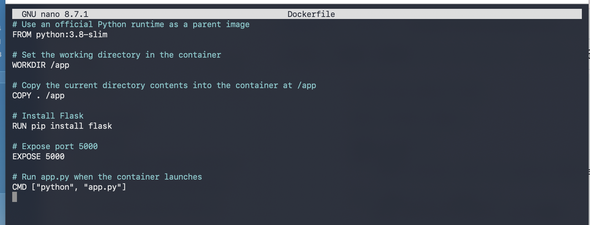
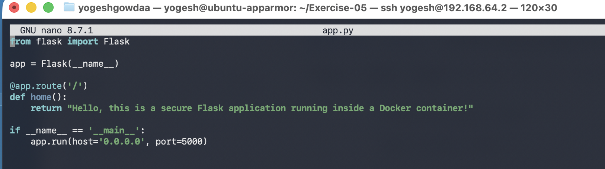
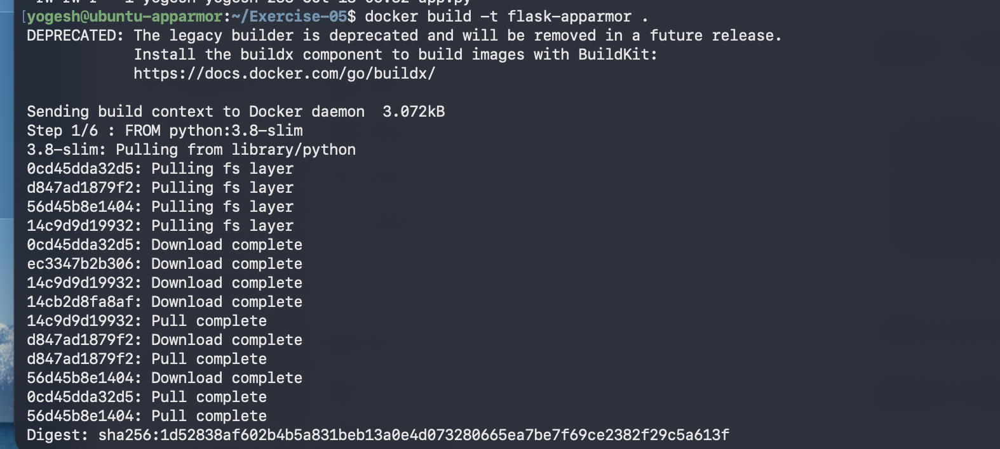
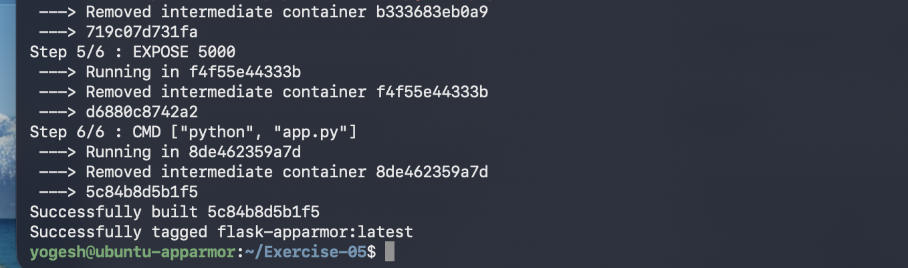
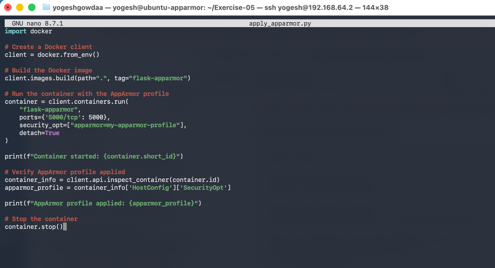
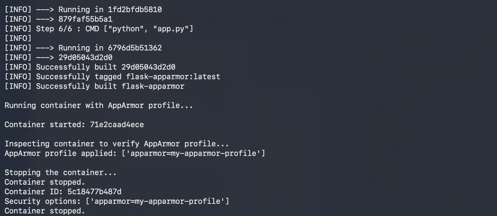
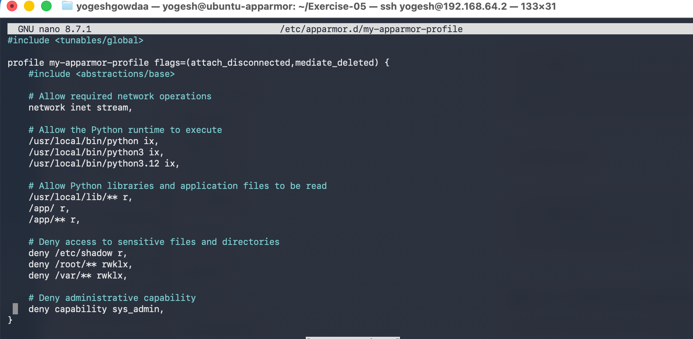
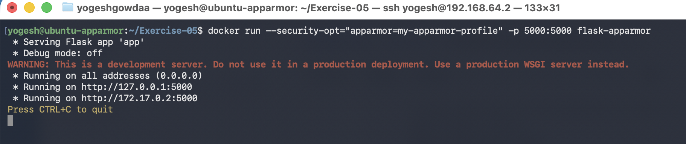
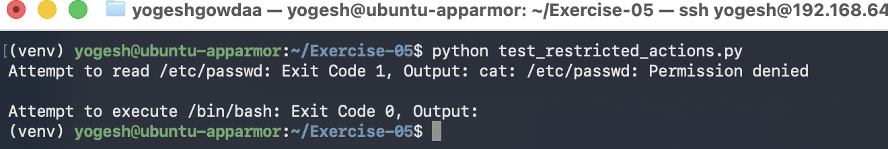
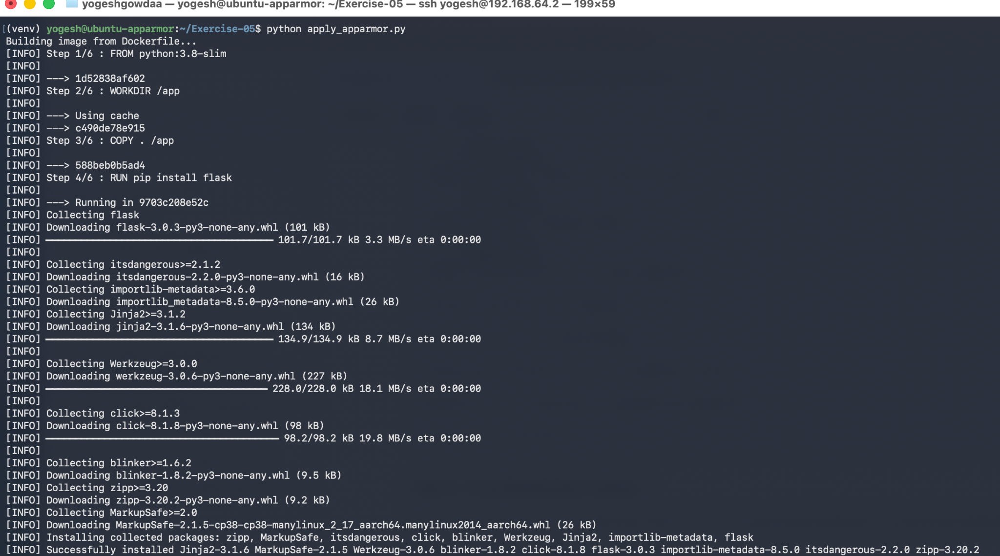

# Exercise 5: Docker Security with AppArmor and Python

## Files

- `app.py`
- `Dockerfile`
- `my-apparmor-profile`
- `apply_apparmor.py`
- `test_restricted_actions.py`

## Run the Flask Application

Build the image:

```bash
docker build -t flask-apparmor .
```

Run the application with AppArmor:

```bash
docker run --security-opt="apparmor=my-apparmor-profile" -p 5000:5000 flask-apparmor
```

Test the application:

```bash
curl http://localhost:5000
```

## Apply AppArmor Using Python

```bash
python apply_apparmor.py
```

## Test Restricted Actions

```bash
python test_restricted_actions.py
```

## Screenshots




















