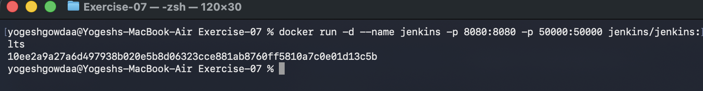
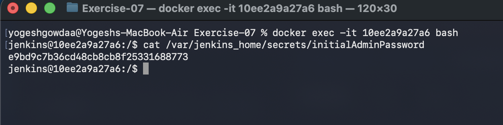
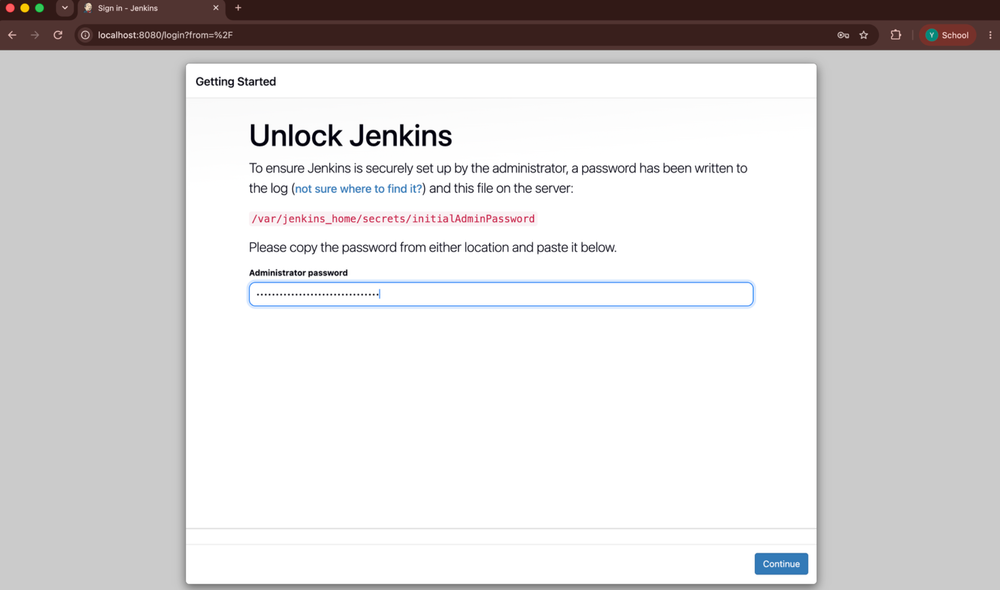
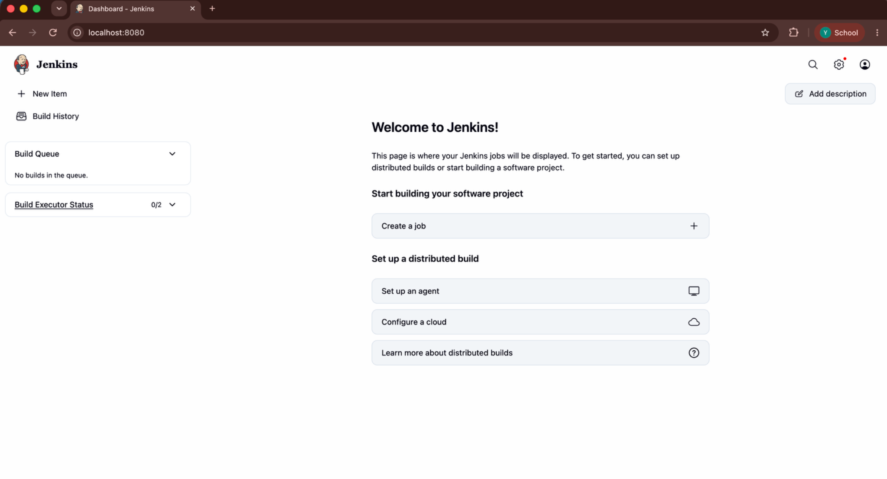

# Exercise 07: Introduction to CI and Jenkins Installation

## Objective
Understand the purpose of Continuous Integration (CI), learn the basic concepts of Jenkins, and run Jenkins in a Docker container.

## Introduction to Continuous Integration (CI)
Continuous Integration is a development practice in which developers frequently integrate code changes into a shared repository. Automated builds and tests help detect integration issues early and provide fast feedback.

### Key features and benefits
- **Frequent integration:** Developers regularly commit changes to a shared repository.
- **Automated builds and tests:** Each change can trigger checks that validate the application.
- **Fast feedback:** Build and test results help developers identify problems early.
- **Improved collaboration and code quality:** Integration problems and regressions can be caught sooner.

### Typical CI workflow
1. A developer commits and pushes a code change.
2. The CI server detects the change or receives a configured trigger.
3. The server builds the application and resolves dependencies.
4. Automated tests run.
5. Results are reported so developers can address failures.

Examples of CI/CD tools include Jenkins, GitHub Actions, GitLab CI/CD, CircleCI, and Azure Pipelines.

## Introduction to Jenkins
Jenkins is an open-source automation server used to automate software build, test, and delivery tasks. It supports CI/CD workflows and can be extended through plugins.

### Key Jenkins concepts
- **Job:** A configured task that Jenkins executes.
- **Build:** An execution of a job or pipeline.
- **Pipeline:** A sequence of automated steps used to build, test, and deliver software.
- **Plugins:** Extensions that add integrations and capabilities.
- **Nodes and agents:** Machines or environments that execute build tasks.

## Jenkins installation using Docker

### 1. Start the Jenkins container
Run the following command:

```bash
docker run -d --name jenkins -p 8080:8080 -p 50000:50000 jenkins/jenkins:lts
```

The `-d` option runs the container in the background. Port `8080` exposes the Jenkins web interface, while port `50000` is used for inbound agent connections. Docker prints the container ID after starting it.



### 2. Retrieve the initial administrator password
Open a shell inside the running container:

```bash
docker exec -it jenkins bash
```

Read the password file:

```bash
cat /var/jenkins_home/secrets/initialAdminPassword
```

Copy the displayed password for the setup wizard. Type `exit` to leave the container shell when finished.



### 3. Unlock Jenkins
Open [http://localhost:8080](http://localhost:8080) in a browser. Enter the initial administrator password in the **Administrator password** field and select **Continue**.



### 4. Verify the Jenkins dashboard
After completing the initial setup flow, confirm that the Jenkins dashboard loads successfully.



## Result
Jenkins was started in Docker, its initial administrator password was retrieved from the container, and the Jenkins dashboard was opened successfully.
