# Exercise 08: Jenkins Job Configuration and Build

## Objective
Create a GitHub repository containing a simple shell script, configure Jenkins to retrieve the script from GitHub, and run it as a Jenkins build.

## Procedure

### 1. Confirm Jenkins is running
Check the existing Jenkins container:

```bash
docker ps -a
```

If the container exists but is stopped, start it:

```bash
docker start jenkins
```

Open Jenkins at [http://localhost:8080](http://localhost:8080).

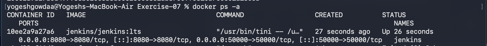

### 2. Create the GitHub repository
Create a public repository named `devops-sample-code`. Leave README, `.gitignore`, and license initialization disabled so the repository is empty before pushing the local commit.

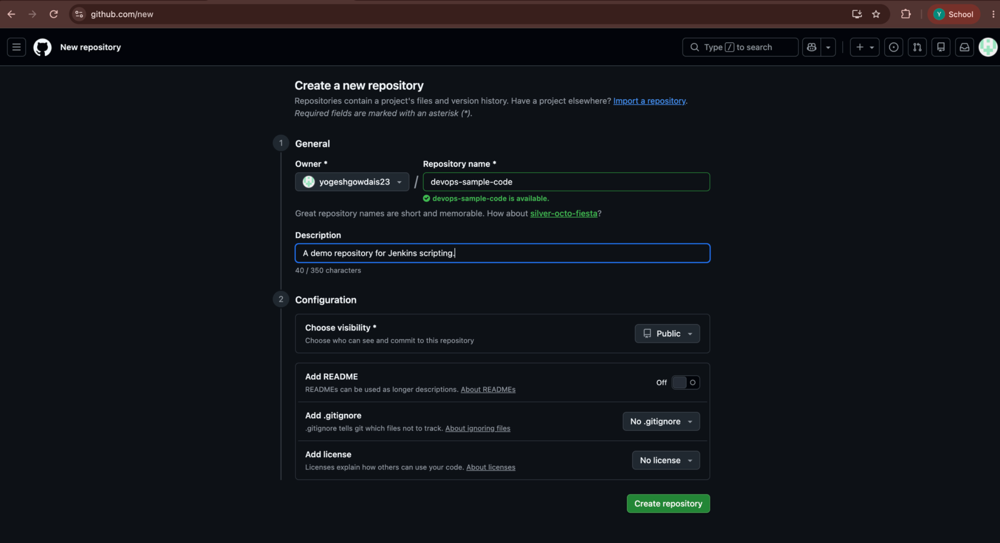

### 3. Create the shell script
Create `hello-world.sh` with the following contents:

```bash
#!/bin/bash
echo "Hello, Jenkins!"
```

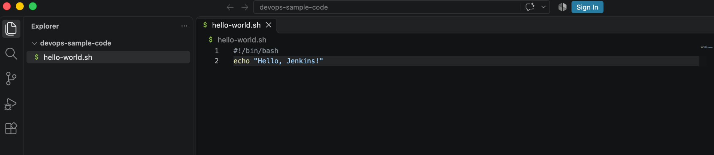

Make the script executable:

```bash
chmod +x hello-world.sh
```

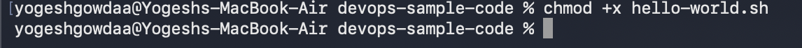

### 4. Initialize Git and commit the script
Configure your Git identity if it has not already been configured, then initialize the repository and stage the script:

```bash
git config --global user.name "Your Name"
git config --global user.email "you@example.com"
git init
git add hello-world.sh
git status
```

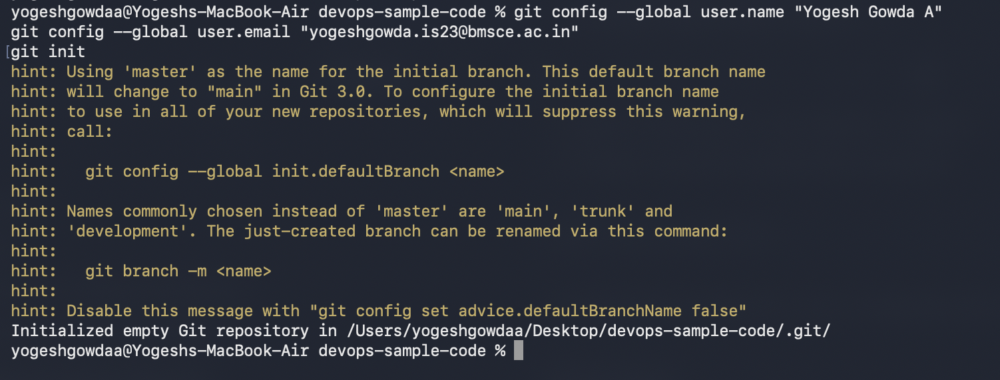

Stage the script and check the staging area:

```bash
git add hello-world.sh
git status
```

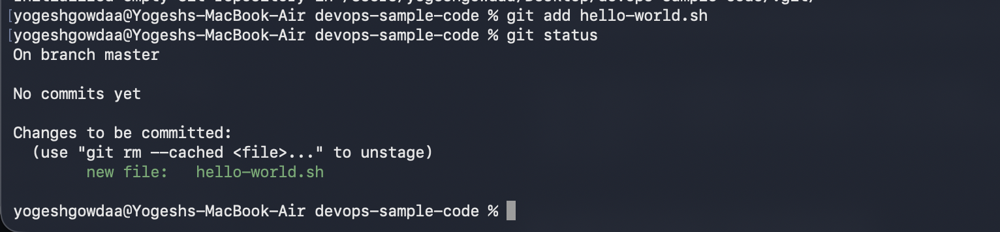

Commit the staged file:

```bash
git commit -m "Add hello-world.sh"
```

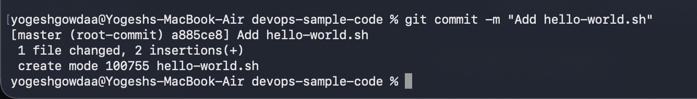

### 5. Connect the local repository to GitHub
Add the repository URL as the `origin` remote. For this exercise:

```bash
git remote add origin https://github.com/yogeshgowdais23/devops-sample-code.git
git branch -M main
git push -u origin main
```

If `origin` already exists, use `git remote set-url origin <repository-url>` instead of adding it again.

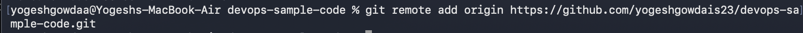

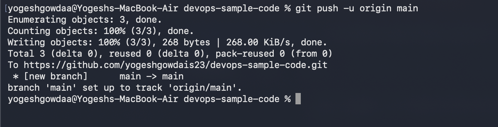

### 6. Open Jenkins and create a job
Open [http://localhost:8080](http://localhost:8080). From the Jenkins dashboard, choose **New Item**, enter a job name such as `HelloWorld`, select **Freestyle project**, and click **OK**.

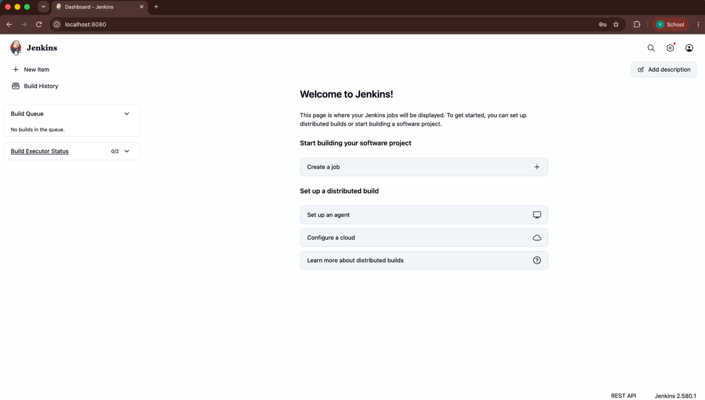

### 7. Configure Source Code Management
In the job configuration:

1. Under **Source Code Management**, select **Git**.
2. Enter the repository URL: `https://github.com/yogeshgowdais23/devops-sample-code.git`.
3. For a public repository, leave credentials as **None**.
4. Set the branch specifier to `*/main`.

If Git is not available as an SCM option, install the Jenkins **Git** plugin under **Manage Jenkins → Plugins**.

### 8. Configure the build step
Under **Build Steps**, select **Execute shell** and enter:

```bash
chmod +x hello-world.sh
./hello-world.sh
```

Save the job and select **Build Now**.

### 9. Verify the build
Open the build's **Console Output**. The output should include:

```text
Hello, Jenkins!
Finished: SUCCESS
```

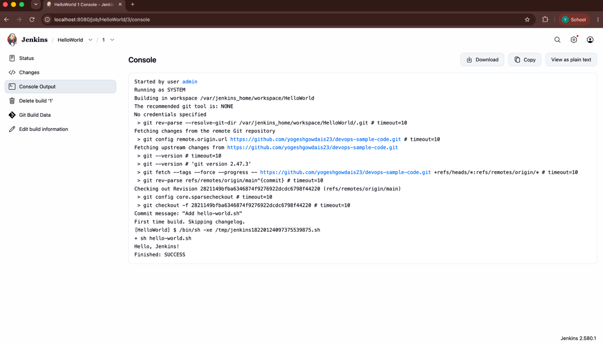

## Result
A shell script was committed to GitHub, retrieved by Jenkins through Source Code Management, and executed successfully as a Jenkins build.
