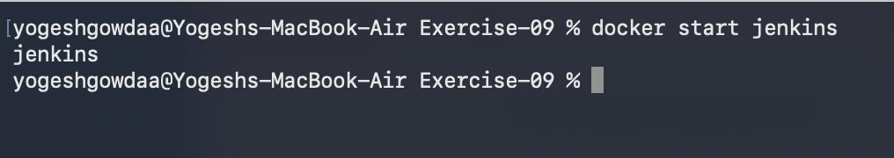
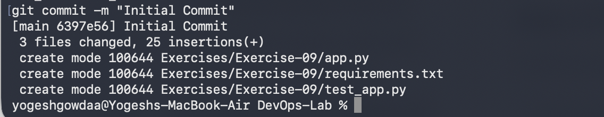
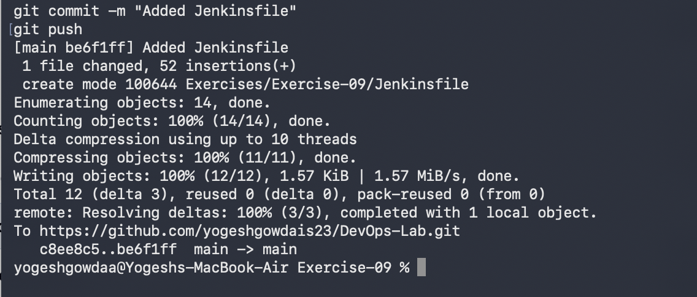
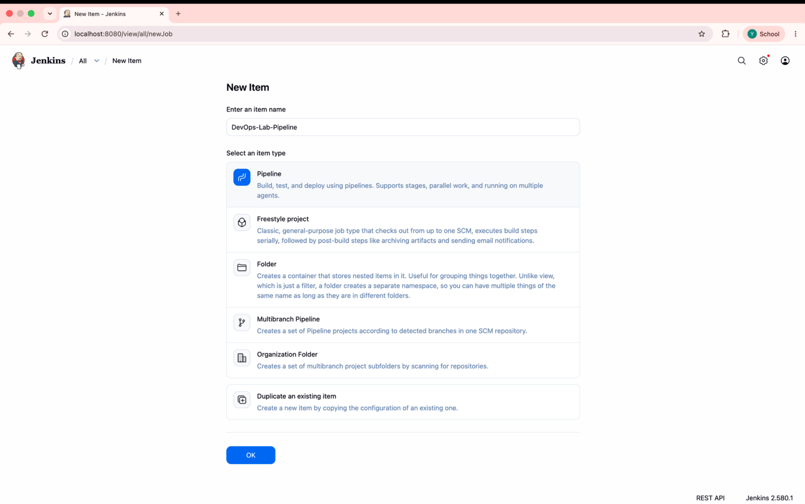
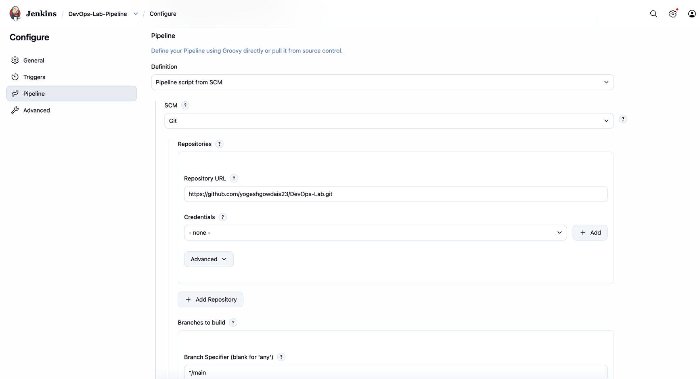
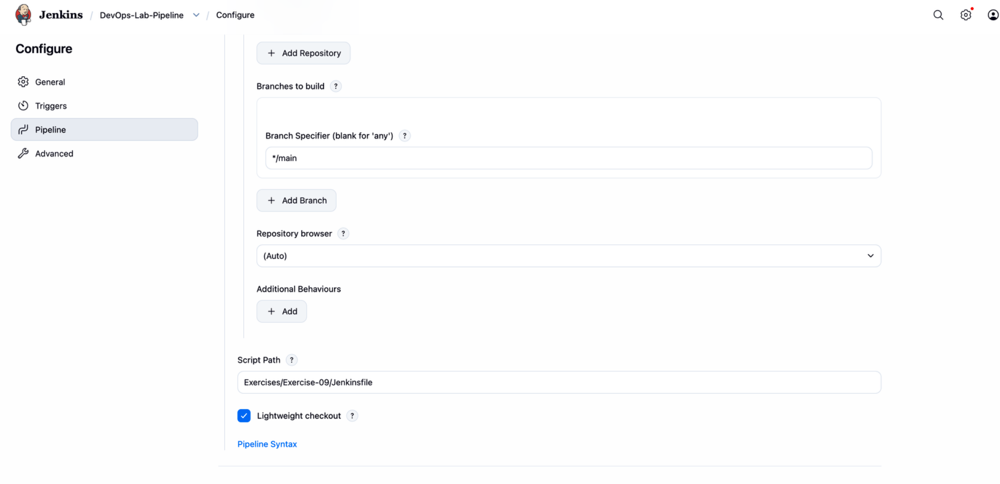
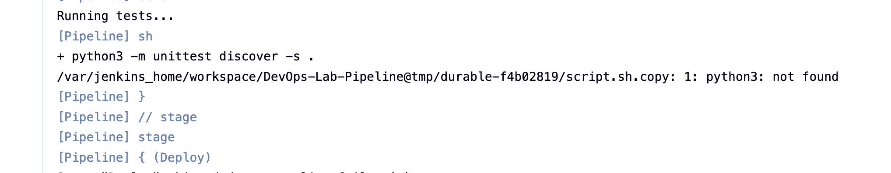
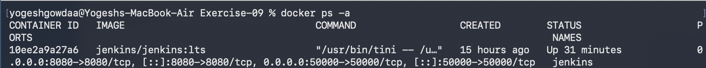
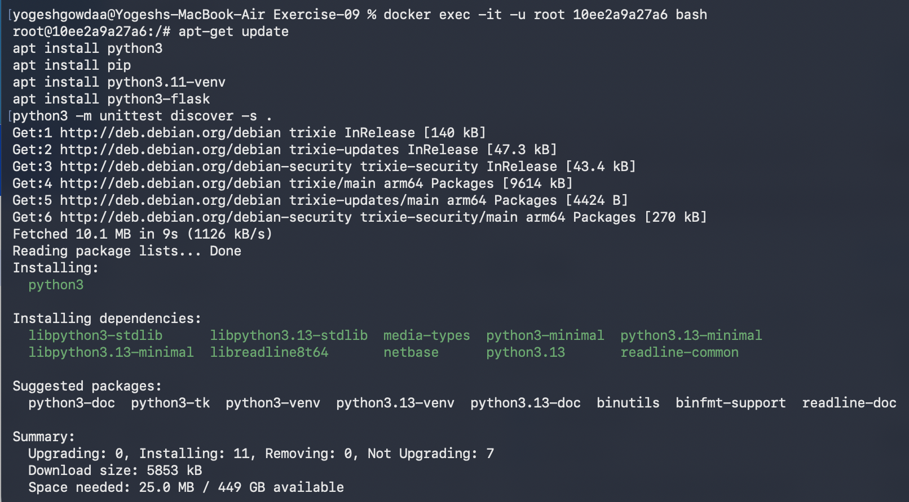
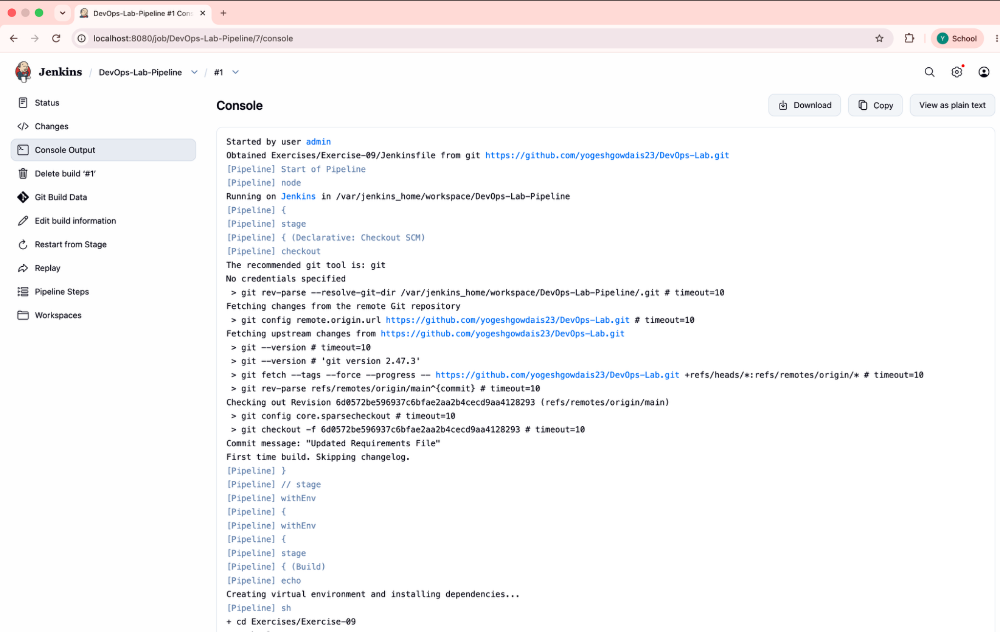

# Exercise 09: Jenkins Multi-Stage Pipeline for a Flask Application

## Objective

Create a Jenkins Declarative Pipeline that checks out the project from GitHub, prepares a Python environment, installs dependencies, runs unit tests, deploys the Flask application to a workspace directory, starts it, and tests the application.

## Project structure

```text
Exercise-09/
├── Jenkinsfile
├── app.py
├── requirements.txt
├── test_app.py
└── screenshots/
    ├── 01-start-jenkins-container.png
    ├── 02-create-application-files.png
    ├── 03-stage-jenkinsfile.png
    ├── 04-commit-and-push-jenkinsfile.png
    ├── 05-create-jenkins-pipeline-job.png
    ├── 06-configure-git-repository.png
    ├── 07-configure-jenkinsfile-path.png
    ├── 08-initial-test-discovery-output.png
    ├── 09-docker-container-details.png
    ├── 10-install-python-in-jenkins-container.png
    └── 11-jenkins-pipeline-run.png
```

## Application and test

- `app.py` defines a Flask route at `/` that returns `Hello, Jenkins Multi-Stage Pipeline!`.
- `test_app.py` uses `unittest` and Flask's test client to verify that the home route returns HTTP 200 and the expected message.
- `requirements.txt` pins Flask and Werkzeug to compatible versions (`Flask==2.1.2`, `Werkzeug==2.1.2`).

## Jenkins configuration

1. Start the Jenkins container and open the Jenkins dashboard.
2. Create a **Pipeline** job.
3. Under **Pipeline**, choose **Pipeline script from SCM**.
4. Set SCM to **Git** and Repository URL to `https://github.com/yogeshgowdais23/DevOps-Lab.git`.
5. Set the branch specifier to `*/main`.
6. Set Script Path to `Exercises/Exercise-09/Jenkinsfile`.
7. Save the job and select **Build Now**.

The Jenkinsfile is stored in `Exercises/Exercise-09/`. The `python-app-deploy` directory is created at runtime inside the Jenkins workspace; it is not an additional source folder in the Git repository.

## Pipeline stages

1. **Build** — creates a virtual environment and installs dependencies from `requirements.txt`.
2. **Test** — discovers and runs `test_*.py` tests with `unittest`.
3. **Deploy** — creates the workspace deployment directory and copies the application and requirements file.
4. **Run Application** — starts `app.py` in the background and checks that the process remains running.
5. **Test Application** — executes `test_app.py` again to verify the application test.

## Commands used

Run these commands from the root of the `DevOps-Lab` repository when committing changes:

```bash
git add Exercises/Exercise-09
git commit -m "Update Exercise 9 Jenkins pipeline"
git push
```

To start an existing Jenkins container:

```bash
docker start jenkins
```

## Screenshots

### Starting Jenkins



### Creating the application files



### Adding and pushing the Jenkinsfile




### Configuring the Jenkins Pipeline job







### Troubleshooting and environment setup







### Successful pipeline run



## Jenkins Console Output

The following output records the successful Jenkins build, including source checkout, dependency installation, passing tests, deployment, application startup, and the final success status.

```text
Started by user admin

Obtained Exercises/Exercise-09/Jenkinsfile from git https://github.com/yogeshgowdais23/DevOps-Lab.git
[Pipeline] Start of Pipeline
[Pipeline] node
Running on Jenkins
 in /var/jenkins_home/workspace/DevOps-Lab-Pipeline
[Pipeline] {
[Pipeline] stage
[Pipeline] { (Declarative: Checkout SCM)
[Pipeline] checkout
The recommended git tool is: git
No credentials specified
 > git rev-parse --resolve-git-dir /var/jenkins_home/workspace/DevOps-Lab-Pipeline/.git # timeout=10
Fetching changes from the remote Git repository
 > git config remote.origin.url https://github.com/yogeshgowdais23/DevOps-Lab.git # timeout=10
Fetching upstream changes from https://github.com/yogeshgowdais23/DevOps-Lab.git
 > git --version # timeout=10
 > git --version # 'git version 2.47.3'
 > git fetch --tags --force --progress -- https://github.com/yogeshgowdais23/DevOps-Lab.git +refs/heads/*:refs/remotes/origin/* # timeout=10
 > git rev-parse refs/remotes/origin/main^{commit} # timeout=10
Checking out Revision 6d0572be596937c6bfae2aa2b4cecd9aa4128293 (refs/remotes/origin/main)
 > git config core.sparsecheckout # timeout=10
 > git checkout -f 6d0572be596937c6bfae2aa2b4cecd9aa4128293 # timeout=10
Commit message: "Updated Requirements File"
First time build. Skipping changelog.
[Pipeline] }
[Pipeline] // stage
[Pipeline] withEnv
[Pipeline] {
[Pipeline] withEnv
[Pipeline] {
[Pipeline] stage
[Pipeline] { (Build)
[Pipeline] echo
Creating virtual environment and installing dependencies...
[Pipeline] sh
+ cd Exercises/Exercise-09
+ python3 -m venv venv
+ [ -f requirements.txt ]
+ venv/bin/python -m pip install -r requirements.txt
Requirement already satisfied: Flask==2.1.2 in ./venv/lib/python3.13/site-packages (from -r requirements.txt (line 1)) (2.1.2)
Collecting Werkzeug==2.1.2 (from -r requirements.txt (line 2))
  Downloading Werkzeug-2.1.2-py3-none-any.whl.metadata (4.4 kB)
Requirement already satisfied: Jinja2>=3.0 in ./venv/lib/python3.13/site-packages (from Flask==2.1.2->-r requirements.txt (line 1)) (3.1.6)
Requirement already satisfied: itsdangerous>=2.0 in ./venv/lib/python3.13/site-packages (from Flask==2.1.2->-r requirements.txt (line 1)) (2.2.0)
Requirement already satisfied: click>=8.0 in ./venv/lib/python3.13/site-packages (from Flask==2.1.2->-r requirements.txt (line 1)) (8.5.0)
Requirement already satisfied: MarkupSafe>=2.0 in ./venv/lib/python3.13/site-packages (from Jinja2>=3.0->Flask==2.1.2->-r requirements.txt (line 1)) (3.1.6)
Downloading Werkzeug-2.1.2-py3-none-any.whl (224 kB)
Installing collected packages: Werkzeug
  Attempting uninstall: Werkzeug
    Found existing installation: Werkzeug 3.1.9
    Uninstalling Werkzeug-3.1.9:
      Successfully uninstalled Werkzeug-3.1.9
Successfully installed Werkzeug-2.1.2
[Pipeline] }
[Pipeline] // stage
[Pipeline] stage
[Pipeline] { (Test)
[Pipeline] echo
Running unit tests...
[Pipeline] sh
+ cd Exercises/Exercise-09
+ venv/bin/python -m unittest discover -s . -p test_*.py -v
test_home (test_app.TestApp.test_home) ... ok

----------------------------------------------------------------------
Ran 1 test in 0.008s

OK
Hello, Jenkins Multi-Stage Pipeline!
[Pipeline] }
[Pipeline] // stage
[Pipeline] stage
[Pipeline] { (Deploy)
[Pipeline] echo
Deploying application...
[Pipeline] sh
+ mkdir -p /var/jenkins_home/workspace/DevOps-Lab-Pipeline/python-app-deploy
+ cp Exercises/Exercise-09/app.py /var/jenkins_home/workspace/DevOps-Lab-Pipeline/python-app-deploy/
+ [ -f Exercises/Exercise-09/requirements.txt ]
+ cp Exercises/Exercise-09/requirements.txt /var/jenkins_home/workspace/DevOps-Lab-Pipeline/python-app-deploy/
[Pipeline] }
[Pipeline] // stage
[Pipeline] stage
[Pipeline] { (Run Application)
[Pipeline] echo
Running application...
[Pipeline] sh
+ cd /var/jenkins_home/workspace/DevOps-Lab-Pipeline/python-app-deploy
+ echo 2643
+ sleep 2
+ nohup python3 app.py
+ cat app.pid
+ kill -0 2643
[Pipeline] }
[Pipeline] // stage
[Pipeline] stage
[Pipeline] { (Test Application)
[Pipeline] echo
Testing application...
[Pipeline] sh
+ cd Exercises/Exercise-09
+ venv/bin/python test_app.py
.
----------------------------------------------------------------------
Ran 1 test in 0.005s

OK
Hello, Jenkins Multi-Stage Pipeline!
[Pipeline] }
[Pipeline] // stage
[Pipeline] stage
[Pipeline] { (Declarative: Post Actions)
[Pipeline] echo
Pipeline execution finished.
[Pipeline] echo
Pipeline completed successfully!
[Pipeline] }
[Pipeline] // stage
[Pipeline] }
[Pipeline] // withEnv
[Pipeline] }
[Pipeline] // withEnv
[Pipeline] }
[Pipeline] // withEnv
[Pipeline] }
[Pipeline] // node
[Pipeline] End of Pipeline
Finished: SUCCESS
```

## Result

The Jenkins multi-stage pipeline completed successfully. The unit test passed, the application was copied to the Jenkins workspace deployment directory and started, and the application test passed. Jenkins reported `Finished: SUCCESS`.
