# Multi-Node Kubernetes Cluster with Multiple Applications and Replicasets

## Objective

Deploy two Flask applications to a three-node Minikube cluster:

- **Product Catalog** — 2 replicas, exposes `GET /products`.
- **Shopping Cart** — 3 replicas, exposes `GET /cart` and `POST /cart`.

Kubernetes Deployments manage the replicas, pod anti-affinity spreads replicas across nodes, and NodePort Services expose the applications.

## 1. Create the multi-node Minikube cluster

Clean up an old default Minikube profile if needed, then create the three-node profile:

```bash
minikube stop
minikube delete
minikube start --nodes 3 -p devops-multinode --force
```

Enable the registry add-on as in the exercise instructions:

```bash
minikube -p devops-multinode addons enable registry
```

> **macOS note:** This cluster uses the Docker Desktop driver, and its Kubernetes nodes use `containerd`. The Docker daemon on your Mac and the container runtime inside Minikube are separate. Therefore, `minikube -p devops-multinode ssh -- docker images` may fail. To inspect images inside the node, use `minikube -p devops-multinode ssh -- sudo crictl images`.

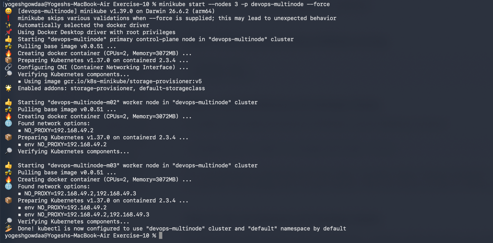

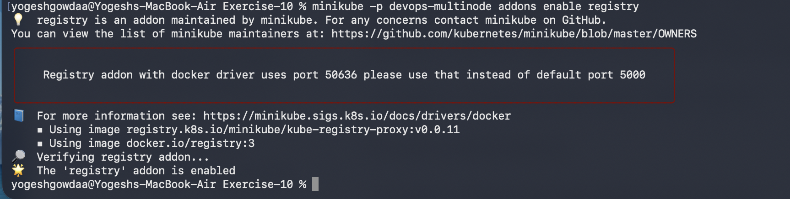

## 2. Build the application images

The application source files and Dockerfiles are maintained separately in this exercise folder. Build both images from the `Exercise-10` directory:

```bash
docker build -t product-catalog:latest -f Dockerfile.product .
docker build -t shopping-cart:latest -f Dockerfile.shopping .
```

List only the two images:

```bash
docker images --format "table {{.Repository}}\t{{.Tag}}\t{{.ID}}\t{{.CreatedSince}}\t{{.Size}}" | grep -E 'REPOSITORY|shopping-cart|product-catalog'
```

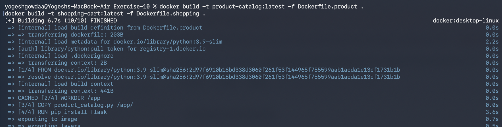

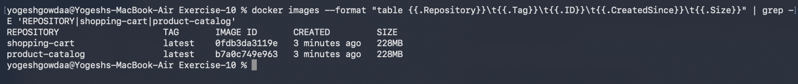

## 3. Make images available to Minikube

Load both local images into the Minikube profile:

```bash
minikube -p devops-multinode image load product-catalog:latest
minikube -p devops-multinode image load shopping-cart:latest
```

Verify images in the control-plane node:

```bash
minikube -p devops-multinode ssh -- sudo crictl images
```

The output showed both `docker.io/library/product-catalog:latest` and `docker.io/library/shopping-cart:latest` available. Because this is a multi-node cluster, check each worker as well if troubleshooting image availability on a particular node.

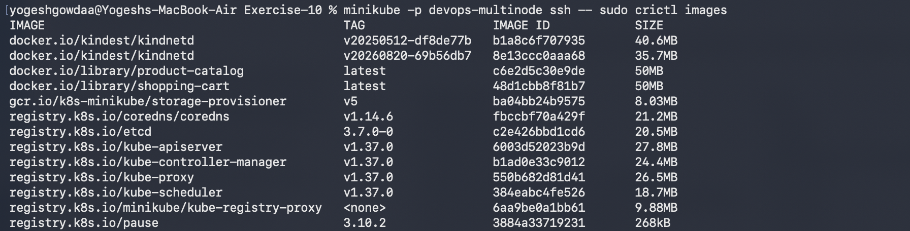

## 4. Deploy the applications

The Deployment manifests configure **2 Product Catalog replicas** and **3 Shopping Cart replicas**. Both Deployment and Service manifests use the `default` namespace in the working setup.

Apply the manifests:

```bash
kubectl apply -f product_catalog_deployment.yaml
kubectl apply -f shopping_cart_deployment.yaml
```

Create the Services:

```bash
kubectl apply -f product_catalog_service.yaml
kubectl apply -f shopping_cart_service.yaml
```

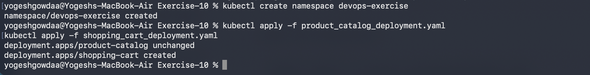

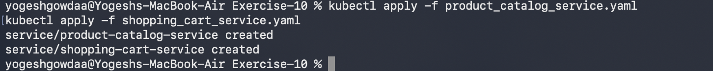

## 5. Verify pod placement and services

```bash
kubectl get pods -o wide
kubectl get services
kubectl get endpoints shopping-cart-service
```

The successful run showed two `product-catalog` pods and three `shopping-cart` pods in `Running` state. Pod anti-affinity is configured to distribute replicas across nodes.

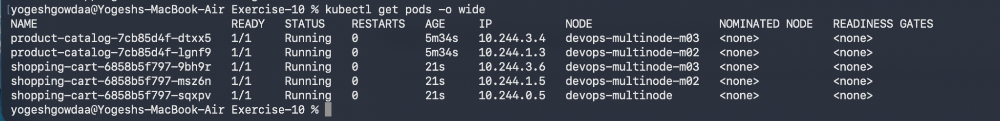

## 6. Access the services

Run each command in a separate terminal and leave that terminal open while using the tunnel:

```bash
minikube -p devops-multinode service product-catalog-service
```

```bash
minikube -p devops-multinode service shopping-cart-service
```

Minikube prints a local tunnel URL and a NodePort URL. The local URL/port is assigned dynamically and can change each time the service command runs; use the URL printed by your current terminal. On macOS with the Docker driver, the tunnel terminal must remain open.

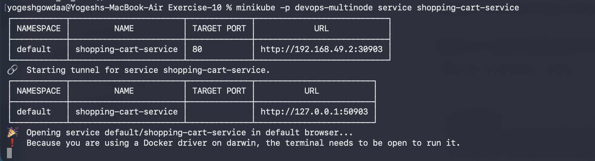

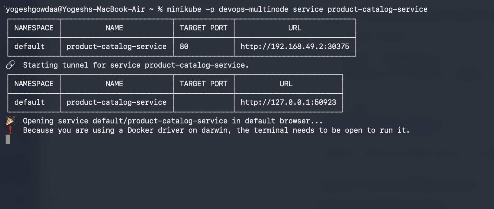

## 7. Test the endpoints with curl

Use the current local tunnel URL printed by Minikube. The examples below use `127.0.0.1:50923` for Product Catalog and `127.0.0.1:50903` for Shopping Cart from the successful run; replace these ports if Minikube prints different ones.

### Product Catalog

```bash
curl http://127.0.0.1:50923/products
```

The response contained the three products: Laptop, Phone, and Headphones.

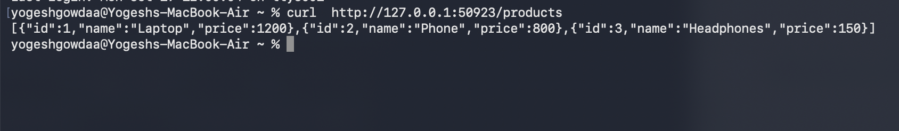

### Shopping Cart

Get the cart:

```bash
curl http://127.0.0.1:50903/cart
```

Add an item:

```bash
curl -X POST http://127.0.0.1:50903/cart \
  -H "Content-Type: application/json" \
  -d '{"id": 1, "name": "Laptop", "quantity": 1}'
```

The successful test first returned an empty list (`[]`) and then returned the cart containing the Laptop item.

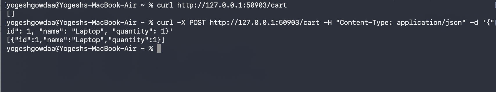

## Summary

This exercise builds two Flask container images, deploys them to a three-node Minikube cluster, distributes two Product Catalog replicas and three Shopping Cart replicas across nodes, exposes them through Kubernetes NodePort Services, and verifies the endpoints using `curl`.
